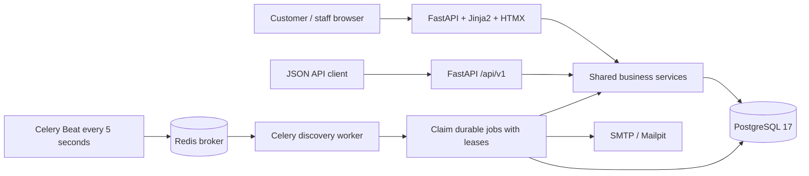
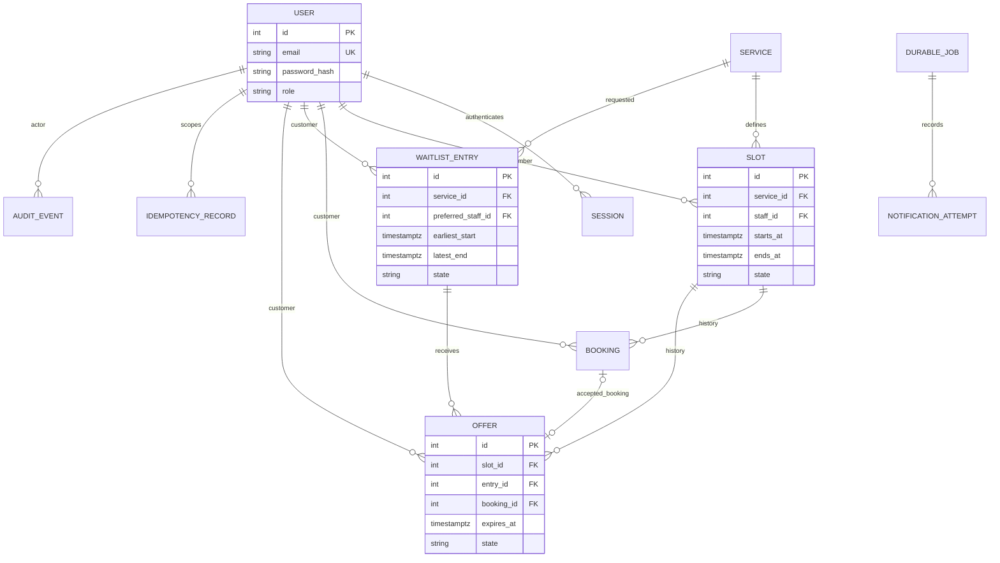
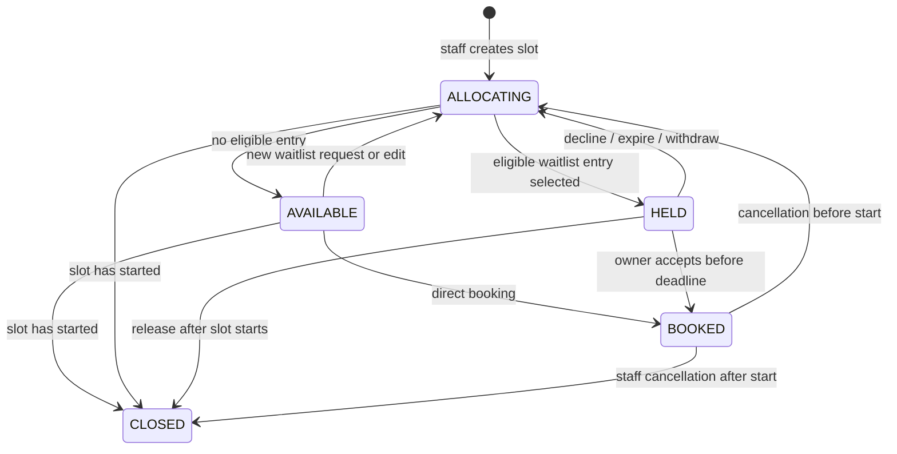

# Architecture and invariants

The database is authoritative for bookings, session authentication, and background work. Redis may lose a discovery message without losing a business event. Beat schedules another scan when it recovers. Web readiness checks the database/migration table, so Redis or SMTP outages do not prevent bookings from committing with durable pending notifications.

## Modules and transaction boundaries

`app/api` and `app/web` parse inputs and select responses. `app/schemas` defines strict Pydantic v2 inputs and API outputs. `app/services` implements authorization, transitions, idempotency, and jobs. `app/repositories/queries.py` holds ownership/pagination/lookup queries. `app/core` contains configuration, security, transitions, errors, and the transaction wrapper. `app/models` maps database records. Alembic creates and evolves the schema; application startup never creates tables.

The `@transactional` decorator commits the service's complete change or rolls it back. Database uniqueness conflicts become 409 errors. Deadlocks and serialization failures are retried at most three times with short increasing delays; unrelated database errors propagate. Reads finish when their request session closes. A task's successful business mutation and job SUCCEEDED status commit in the same transaction. An email is an external side effect with the explicit delivery limitation below.

## Relationships

All history records have immutable identities, foreign keys, and timezone-aware timestamps. Login counters are an additional small database table. Audit records contain actor, action, resource, time, request/job correlation, and concise details, without passwords or session tokens.

## Slot states

The single transition registry is `app/core/states.py`. A repeated successful cancellation/withdrawal returns the current final result without another transition. Accepting an already accepted offer returns its booking. Other terminal transitions conflict.

| Record | Valid transitions |
| --- | --- |
| Booking | CONFIRMED → CANCELED or COMPLETED |
| Offer | ACTIVE → ACCEPTED, DECLINED, EXPIRED, or REVOKED |
| Waitlist entry | ACTIVE → FULFILLED or WITHDRAWN |

COMPLETED is reserved in the state model; this version does not automatically complete historical bookings or expose a completion endpoint.

## Preventing double-booking

1. Lock the slot row with `SELECT ... FOR UPDATE` and refresh its state from the database.
2. Recheck that it has not started and its service is active. Direct booking additionally requires AVAILABLE; acceptance requires HELD plus the owner's active offer and entry.
3. Insert a confirmed booking, transition the slot to BOOKED, write its audit event, and insert the confirmation job.
4. Commit everything together. A waiter on the row lock observes the committed new state and receives 409. Failed transactions publish no success and leave no partial booking or notification job.

The database provides additional defenses:

| Invariant | Enforcement |
| --- | --- |
| At most one confirmed booking per slot | Partial unique booking index |
| At most one active offer per slot | Partial unique offer index |
| At most one active offer per entry | Partial unique offer index |
| No booking and offer can occupy a slot together | Deferred constraint triggers lock the slot and validate combined occupancy and slot state at commit |
| No repeated offer for one entry/slot pair | Historical unique constraint |
| No identical active waitlist request | Partial expression unique index, treating no preferred staff consistently |
| No overlapping intervals for one staff member | `btree_gist` + GiST exclusion on staff equality and half-open `tstzrange` overlap |
| Slot duration and staff role are valid | Interval/staff trigger; service row locked during slot creation |
| Duration changes cannot invalidate future slots | Service lock, service check, and database trigger |
| Booked/held or historical intervals cannot be edited | Service checks and database triggers |
| Valid states and basic intervals | CHECK constraints |

Owner checks, future start checks, active service checks, FIFO selection, deadline validation, and complete business transitions require the service transaction. Database constraints supplement those rules; they do not replace authorization.

## Lock ordering and allocation

An idempotency advisory **transaction** lock, when needed, comes first. Its stable signed 64-bit hash scopes concurrent retries by user, operation, and key. It is a PostgreSQL coordination mechanism, separate from the slot row lock. Next lock slot → waitlist entry → offer/booking. Job processing first locks its own job before entering this order. Slot creation/editing locks the target service before the slot; operations holding a slot do not then acquire a conflicting service lock. Service duration updates do not acquire slot row locks.

Allocators serialize on the slot, then choose the earliest ACTIVE matching waitlist entry by `(created_at, id)`. The full slot interval must fit, any preferred staff must match, the entry must have no active offer, and the pair must never have been offered before. They deliberately wait for the earliest candidate's entry lock instead of skipping ahead in the queue. After acquiring it they recheck active occupancy with a fresh query: a different slot's allocator may have won that entry while they waited. If so, continue with the next eligible entry. The unique entry index is a final defense.

An allocator creates the offer, marks HELD, schedules its expiration, records a concise selection explanation, and queues its email in one transaction. No candidate returns the slot to AVAILABLE. New slots allocate too. Joining a waitlist also queues matching already available slots; an ordinary direct booking can win an already AVAILABLE slot until that allocator locks it. A canceled slot has already moved to ALLOCATING in its cancellation transaction, so that recovery queue cannot be bypassed by direct booking.

Withdrawal first identifies any active offer, locks its slot, then locks the entry and rechecks. If an offer appeared while it was waiting, it releases locks and starts from a fresh snapshot, at most three times. It never reverses the slot/entry locking order. Withdrawing revokes a current offer and queues the next allocation.

## Expiration and idempotency

Acceptance compares `expires_at` to PostgreSQL `clock_timestamp()` after acquiring the locks. Unlike `now()`, this advances during a transaction and cannot preserve an expired offer because the request waited for a lock. Offer expiry is capped at the slot start. Browser countdowns use the server's sampled time plus elapsed browser time and remain informational. A late email never changes an expiry.

On acceptance rejection the response is a conflict; the durable expiration job remains responsible for releasing the expired hold. A temporarily stopped worker can delay availability, but cannot allow a late acceptance.

Booking and acceptance accept `Idempotency-Key` (1–128 characters). A transaction-scoped advisory lock serializes concurrent use of the same scope. A fingerprint includes the requested slot/offer ID. The successful response and business mutation commit together. Replays return the original response; reuse with different input returns 409. Failed operations do not consume keys. Records currently have no automatic retention limit. Retried cancellation and withdrawal are naturally idempotent; offer/booking uniqueness and state checks make retried tasks harmless.

PostgreSQL references: [range exclusion constraints](https://www.postgresql.org/docs/17/rangetypes.html#RANGETYPES-CONSTRAINT), [row locking](https://www.postgresql.org/docs/17/explicit-locking.html#LOCKING-ROWS), [SQLAlchemy PostgreSQL exclusion constraints](https://docs.sqlalchemy.org/en/20/dialects/postgresql.html#sqlalchemy.dialects.postgresql.ExcludeConstraint).
